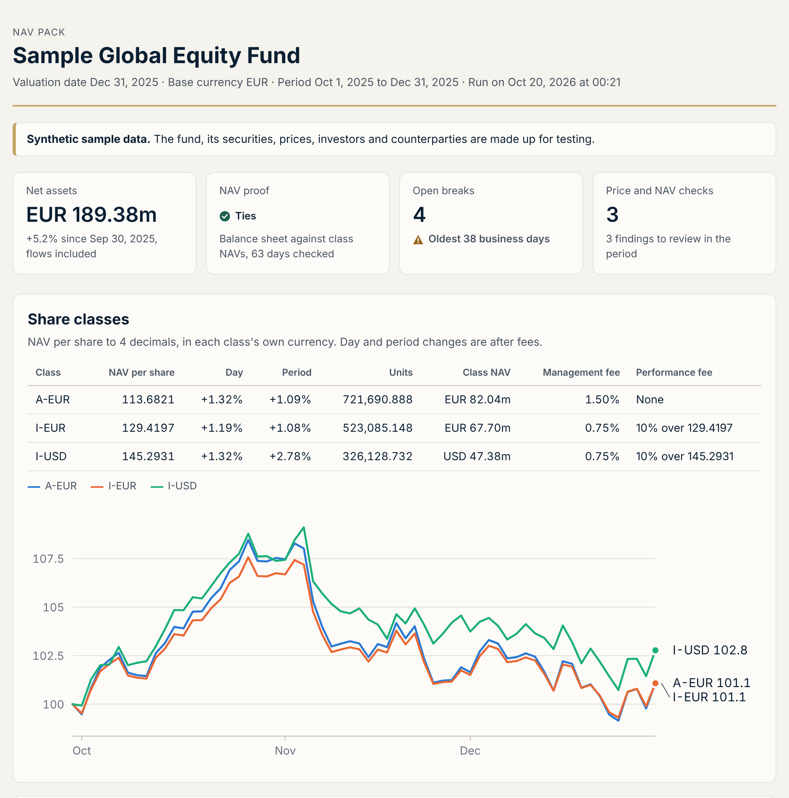
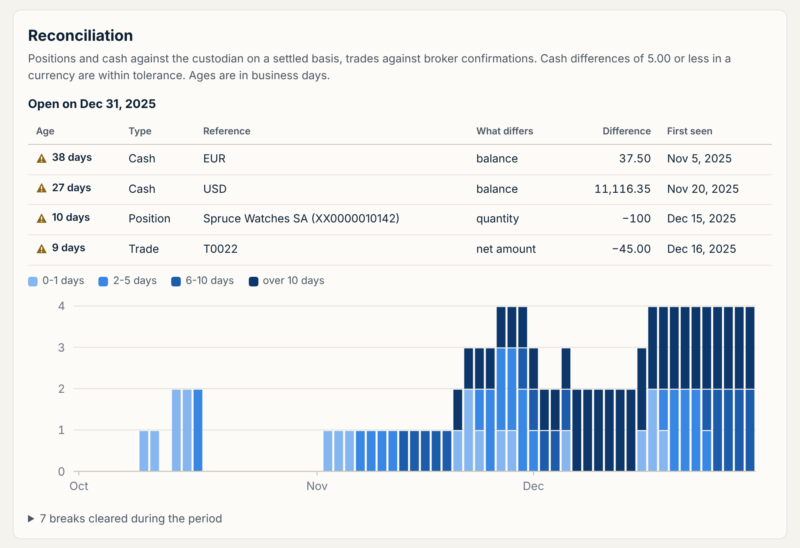

# Fund NAV engine

[](https://github.com/sswnair/fund-nav-engine/actions/workflows/tests.yml)

Calculates a fund's daily NAV for each share class, then reconciles the books to the custodian and the brokers. It handles fee accruals, share classes in different currencies, performance fees, investor dealing and reconciliation breaks.



## What happens each day

1. Trades are booked on trade date and settled on their contractual settlement date. Dividends accrue on the ex-date and are collected on the pay date.
2. Holdings, cash and amounts due in or out are valued in euros at the day's prices and FX rates.
3. The shared expenses accrue: administration, depositary and audit.
4. The fund's result for the day is split between the share classes by their NAV at the previous valuation point.
5. Each class is charged its own management fee and performance fee, and its NAV per share is calculated in its own currency.
6. Subscriptions and redemptions deal at that NAV per share.
7. The NAV is proved: net assets from the balance sheet have to equal the sum of the class NAVs, to the cent.
8. Positions and cash are reconciled with the custodian, trades with the broker confirmations, and every break is aged in business days.

## The sample fund

A made-up global equity fund that starts the fourth quarter of 2025 with EUR 180m in 14 stocks across four currencies. The quarter has 63 valuation days, 26 trades, 13 subscriptions and redemptions, and 6 dividends.

| Class | Currency | Management fee | Performance fee | NAV per share, Sep 30 | Dec 31 |
|---|---|---|---|---|---|
| A-EUR | EUR | 1.50% | None | 112.4530 | 113.6821 |
| I-EUR | EUR | 0.75% | 10% above the high-water mark | 128.0400 | 129.4197 |
| I-USD | USD | 0.75% | 10% above the high-water mark | 141.3700 | 145.2931 |

The NAV proof ties on all 63 days.

The performance fees crystallize on December 31: EUR 460,299.24 on I-EUR and USD 416,469.65 (EUR 348,393.55) on I-USD, and both high-water marks move up to the year-end NAV per share. Two redemptions during the quarter crystallize the fee on the redeemed units when they leave. Without that step, the next day's accrual would be calculated on fewer units, and the fee on the units that left would go back to the investors who stayed.

The custodian statements and broker confirmations come with 10 planted problems, which produce the 11 breaks listed in `data/sample/expected_breaks.csv`, and the reconciliation finds all 11. Among them are a purchase that failed to settle for three days, a custody charge the books never picked up, a dividend withheld at 30% instead of 15%, a scrip dividend booked only at the custodian, a mispriced confirm, a confirm that arrived six days late, and a confirm for a trade the fund never made. Seven clear during the quarter. Four are still open at year end, the oldest after 38 business days. A 40p difference on the sterling account is inside the GBP 5.00 tolerance and never shows up as a break.

The day-end checks catch a price that stopped updating for four days and a genuine 14% one-day fall in one of the holdings.



## Quick start

```bash
git clone https://github.com/sswnair/fund-nav-engine.git
cd fund-nav-engine
python3 -m venv .venv && source .venv/bin/activate
pip install -e ".[dev]"

fundnav run --sample
```

The run writes a NAV pack (one self-contained HTML page) to `output/`, along with CSV files of the NAV history, daily balance sheets, dealing, the break register, the breaks found each day, the checks, and the ledger's trades, dividends, settlements and fee payments.

To run another fund, lay its files out like `data/sample` and point the tool at the folder:

```bash
fundnav run --data path/to/fund --out output
fundnav fx --start 2025-10-01 --end 2025-12-31 --currencies USD GBP CHF
```

The second command downloads the ECB's euro reference rates in the format `fx.csv` uses. With `--fail-on-breaks`, `run` exits with code 2 when a break is open or the proof fails.

## Conventions

- Base currency EUR. FX rates are units of each currency per euro, the ECB's convention, so converting to euros means dividing by the rate.
- Fees accrue daily on an actual/365 basis, for the calendar days since the previous valuation day. A Monday carries the weekend.
- Administration and depositary fees are a rate on total net assets, and audit is a fixed EUR 24,000 a year. These shared expenses come out of the day's result before it is split between the classes.
- The management fee is charged on the class NAV after the day's shared expenses and before the class's own fees.
- The performance fee is 10% of the rise in NAV per share above the high-water mark, recalculated every day on the NAV per share before the fee. It crystallizes at year end and on redemption.
- NAV per share is rounded half up to 4 decimals. Units are issued to 3 decimals, rounded down, and redemption proceeds are rounded down to the cent, so the rounding on units and proceeds favors the fund.
- Cash and settled positions move on the contractual settlement date, and the custodian is reconciled on a settled basis.
- Fees accrued in one month are paid on the first valuation day of the next.

## How it is organized

```
data.py         reads a fund's files; downloads ECB reference rates
ledger.py       the books: positions on trade date and settlement date, cash, amounts due, accrued fees
valuation.py    holdings and cash in base currency
accruals.py     daily fee accruals
classes.py      splitting the result between classes, NAV per share, valuing a class
perf_fee.py     performance fee accrual and crystallization
dealing.py      units issued and proceeds paid
reconcile.py    positions and cash against the custodian, trades against the brokers
aging.py        the break register and business-day ages
checks.py       stale prices, large price, FX and NAV moves
engine.py       the daily run and the NAV proof
report.py       the NAV pack and CSV outputs
cli.py          the fundnav command
```

## Limitations

- There is no equalization. An investor who subscribes partway through the year bears the performance fee from that day on, including on gains made before they arrived. Equalization credits or series accounting would fix that.
- When a month ends on a weekend, those days accrue on the next valuation day and are paid with the following month's fees. All fees, audit included, are paid monthly for simplicity.
- Classes are unhedged. A hedged class would need FX forwards and a way to give the hedge's result to that class alone.
- There are no FX trades between cash accounts, so each purchase is paid from cash in its own currency.
- Income is cash dividends only. Splits, rights issues and other corporate actions are not booked.
- Prices come from a pricing file as they are, with no fair value adjustments.
- This is a portfolio project, not a production fund accounting system.

## Tests

```bash
pytest
```

163 tests: worked examples for every fee, allocation, performance fee and dealing rule, the reconciliation and aging rules, and a full run of the sample fund checked against the list of planted breaks.

---

Sanjay Nair, CFA · [sswnair.github.io](https://sswnair.github.io)
